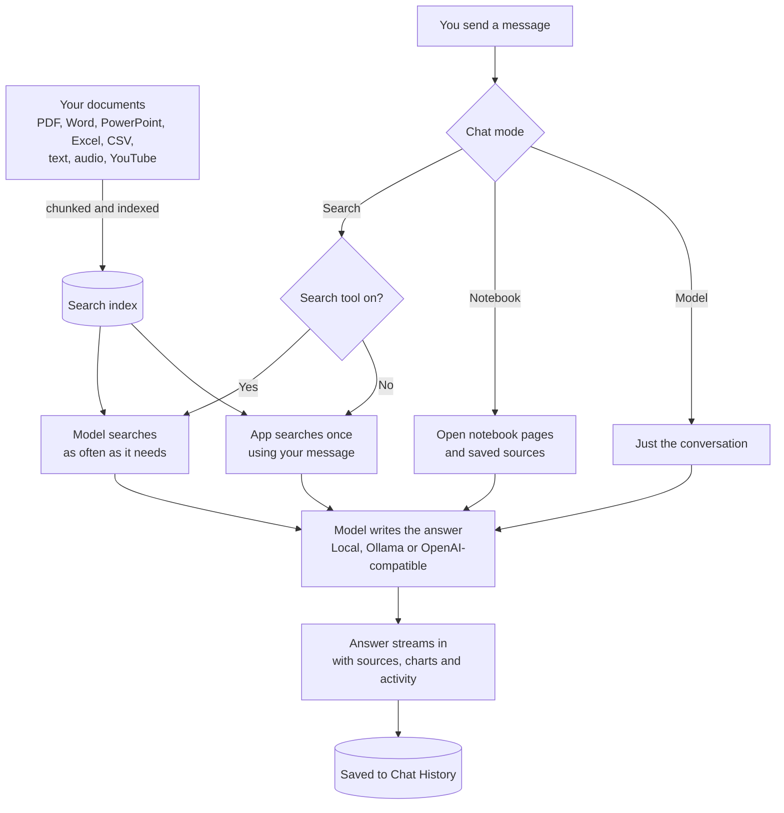

# Chat pipeline

What happens when you send a message.

- **Search** (default) answers from your active documents.
- **Notebook** answers from the open notebook instead of the library.
- **Model** is a plain chat with no documents and no tools.
- Every mode sends the last 20 messages, so follow-up questions work.
- With tools on, the model gets 6 rounds of tool calls by default, then it has to answer.
- Documents marked local only are never sent to anything but the local model.

## Where the code is

| Step                | File                                                 |
| ------------------- | ---------------------------------------------------- |
| Endpoint            | `src/routes/(app)/sessions/[id]/messages/+server.ts` |
| Prompt building     | `src/lib/server/chat/build-chat-messages.ts`         |
| One-shot search     | `src/lib/server/chat/auto-search.ts`                 |
| Model and tool loop | `src/lib/server/agent/runner.ts`                     |
| System prompts      | `src/lib/server/agent/prompts.ts`                    |
| Model providers     | `src/lib/server/providers/`                          |

Return to [docs](README.md).
