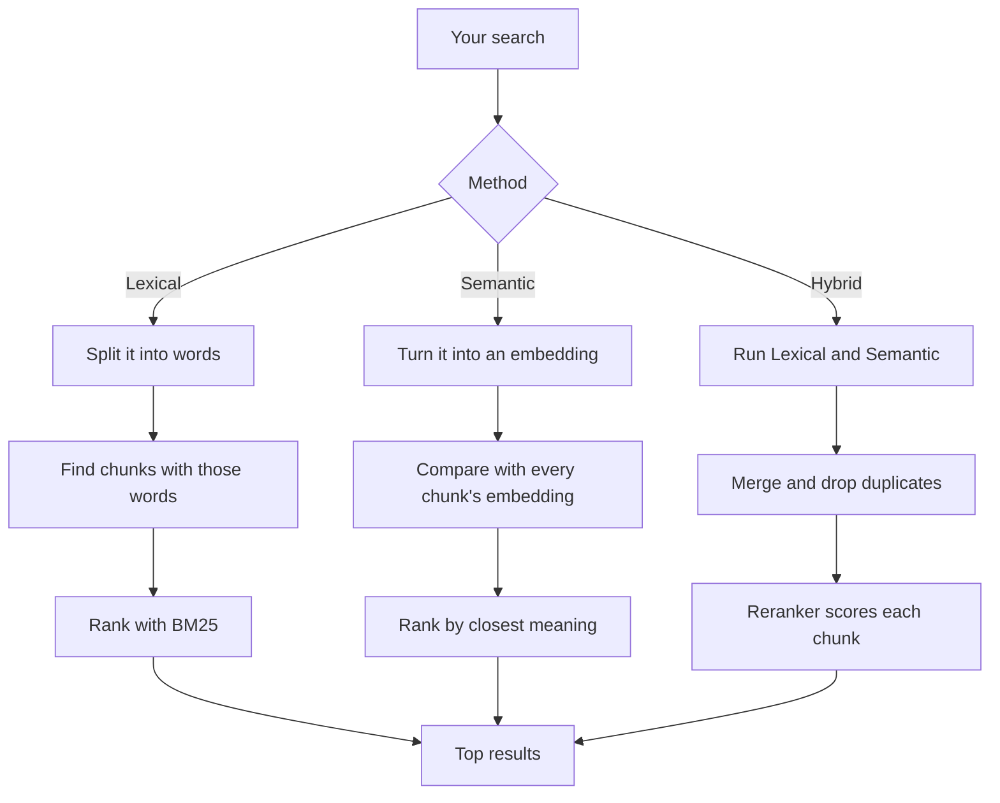

# Documents and search

## Adding a document

1. The app saves its own copy in `documents/`. Your original file is never touched, and adding
   the same file twice doesn't make a duplicate.
2. It pulls out the text:

   | Type             | How                                              |
   | ---------------- | ------------------------------------------------ |
   | PDF              | Text layer, plus OCR for images and scans        |
   | Word, PowerPoint | Converted to PDF first                           |
   | Excel, CSV       | Cell and row data                                |
   | Text, Markdown   | Read as-is                                       |
   | Audio            | Transcribed on your machine, with speaker labels |
   | YouTube          | The video's captions                             |

3. It cuts the text into **chunks** of about 1,200 characters. Each chunk remembers its page,
   sheet or timestamp, which is how answers link back to the exact spot.
4. Chunks go into a keyword index and get an **embedding** for meaning search. CSV files are
   keyword-only. See [Embeddings and models](EMBEDDINGS.md).

## Searching

Only **active** documents are searched.

| Method       | Good for                        |
| ------------ | ------------------------------- |
| **Lexical**  | Names, codes, exact phrases     |
| **Semantic** | Questions in your own words     |
| **Hybrid**   | Almost everything (the default) |

The code is in `src/lib/server/documents/` (adding files) and `src/lib/server/rag/` (chunking,
embeddings and search).

Return to [docs](README.md).
