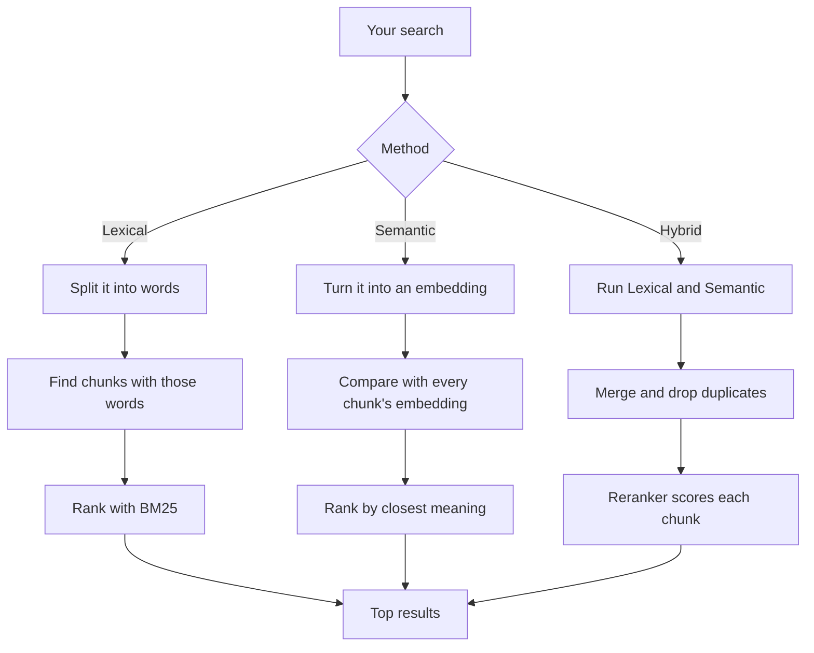

# Documents and search

## Adding a document

1. The app saves its own copy in `documents/`. Your original file is never touched, and adding
   the same file twice doesn't make a duplicate.
2. It pulls out the text:

   | Type             | How                                              |
   | ---------------- | ------------------------------------------------ |
   | PDF              | Text layer, plus OCR for images and scans        |
   | Word, PowerPoint | Converted to PDF first                           |
   | Excel, CSV       | Cell and row data                                |
   | Text, Markdown   | Read as-is                                       |
   | Audio            | Transcribed on your machine, with speaker labels |
   | YouTube          | The video's captions                             |

3. It cuts the text into **chunks** of about 1,200 characters. Each chunk remembers its page,
   sheet or timestamp, which is how answers link back to the exact spot.
4. Chunks go into a keyword index and get an **embedding** for meaning search. CSV files are
   keyword-only. See [Embeddings and models](EMBEDDINGS.md).

## Searching

Only **active** documents are searched.



| Method       | Good for                        |
| ------------ | ------------------------------- |
| **Lexical**  | Names, codes, exact phrases     |
| **Semantic** | Questions in your own words     |
| **Hybrid**   | Almost everything (the default) |

## Exporting and importing

A group or a selection of documents can be exported as one zip (`POST /documents/export`). The
zip is streamed, so a large export never sits in memory.

```
documents.zip
├── manifest.json
└── documents/
    └── 001-quarterly-report/
        ├── document.json
        ├── original.pdf
        ├── chunks.jsonl
        └── embeddings.npy
```

| File             | Contents                                                                                                                                                                                                                            |
| ---------------- | ----------------------------------------------------------------------------------------------------------------------------------------------------------------------------------------------------------------------------------- |
| `manifest.json`  | `format`, `formatVersion` (2), app version, export time, the embedding `model` and `dimensions`, and every document with its folder and chunk counts                                                                                |
| `document.json`  | Title, type, origin, tags, active and local-only flags, dates, `syncedFrom` (folder id and name, path in the folder, and the file's size and date) for synced files, `storedFile` (the stored copy's name), `sourceUrl` for YouTube |
| `original.<ext>` | The app's stored copy. Word and PowerPoint are the converted PDF; YouTube has none                                                                                                                                                  |
| `chunks.jsonl`   | One chunk per line in reading order: `id`, `chunkIndex`, `pageIndex`, `chunkType`, `content`, `startMs`, `endMs`, `speaker`, `embeddingRow`                                                                                         |
| `embeddings.npy` | NumPy float32 matrix, one row per embedded chunk. `embeddingRow` points into it; `null` means the chunk has no vector from the current model (CSV, or not re-embedded yet)                                                          |

`POST /documents/import` takes the zip as the request body and streams progress back. It reads
nothing again: each document is restored under its `storedFile` name, which gives it the same id as
in the library it came from, so documents the library already has are skipped. Chunks keep their ids
and vectors; a vector from another model, or a chunk without one, is re-embedded in the background.
A document that fails validation is reported and the rest still import. The format lives in
`document-package.ts`.

Import reads every format version, because an export may be the only copy of a library. Bump
`PACKAGE_FORMAT_VERSION` when an older reader would misread the new layout:

| Version | Change                                                                                                  |
| ------- | ------------------------------------------------------------------------------------------------------- |
| 1       | `syncedFrom` has only `folder` and `relativePath`. The earliest exports have no `storedFile`            |
| 2       | `syncedFrom` adds `folderId`, `folderName`, `lastModified` and `size`, so import can restore the folder |

Documents from a synced folder go back into that folder, which is created with the exported id and
name if the library doesn't have it. The browser holds no handle for it, so it shows as "reconnect
needed" until it is pointed at a copy on disk. On that first sync, files whose exported size and
date still match are skipped, and the rest are matched to their stored copy by content hash, so
unchanged files aren't processed again.

The code is in `src/lib/server/documents/` (adding, exporting and importing files) and
`src/lib/server/rag/` (chunking, embeddings and search).

Return to [docs](README.md).
