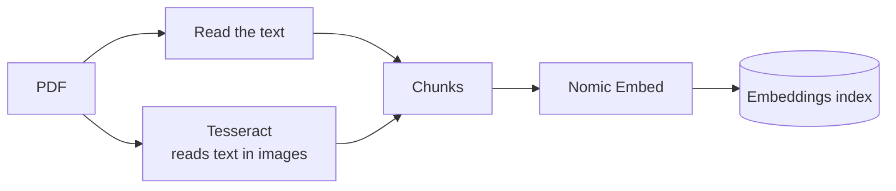
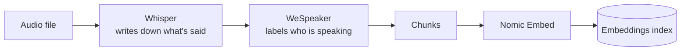
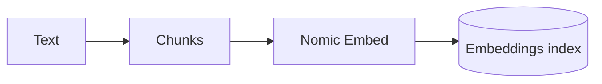
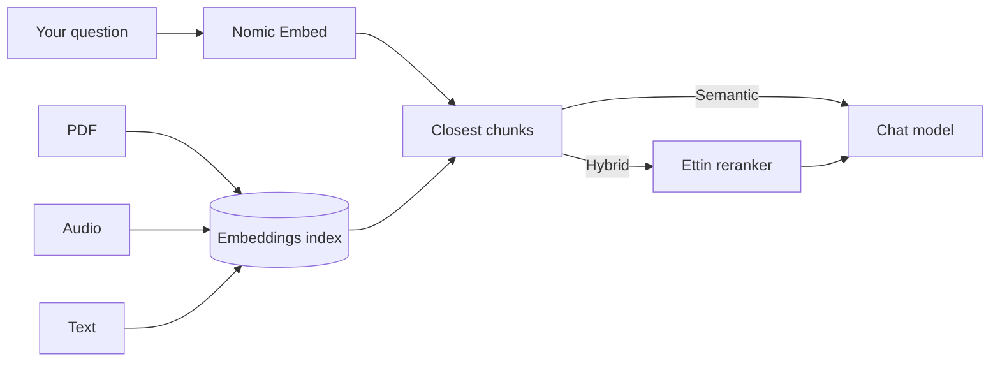

# Embeddings and models

Every model the app uses, and where it fits. All of them run on your machine. The setup page
downloads them on first run, and anything skipped there downloads the first time it's needed.

### PDF, Word and PowerPoint

Word and PowerPoint files are converted to PDF first.

### Audio

### Text and everything else

Text, Markdown, Excel and YouTube captions need no extra model. CSV files skip embedding.

### Searching and answering

## The models

| Model                           | Job                                       | Stored in                |
| ------------------------------- | ----------------------------------------- | ------------------------ |
| **Gemma 4** (E2B, E4B, 26B A4B) | Writes answers and names new chats        | `models/`                |
| **Nomic Embed Text v1.5**       | Turns chunks and searches into embeddings | `.cache/embeddings/`     |
| **Ettin Reranker 32M**          | Picks the best results in Hybrid search   | `.cache/transformersjs/` |
| **Whisper tiny (English)**      | Transcribes audio                         | `.cache/transformersjs/` |
| **WeSpeaker**                   | Tells speakers apart in audio             | `.cache/transformersjs/` |
| **Tesseract (English)**         | Reads text in images and scanned pages    | `.cache/tessdata/`       |

Instead of Gemma, chat can use any model in Ollama or an OpenAI-compatible API. Embeddings can
come from an OpenAI-compatible API too.

## What an embedding is

An embedding is a list of numbers that captures what a piece of text means. Texts about the same
thing get similar numbers, even when they use different words. That's what lets Semantic search
find "applying a tourniquet" when you search "stop the bleeding".

## How embeddings are used

- **Semantic search** compares your search's embedding with every chunk's.
- **Autotag** compares your tag names with a document's embeddings to pick tags that fit.
- **Switching embedding model** re-embeds everything in the background. Embeddings from
  different models can't be compared, so Semantic search only finds what's been redone so far.
- **Local-only documents** are only embedded by a local embedding model.
- **CSV files** aren't embedded. They're found by keyword search, and Python can read them.

The code is in `src/lib/server/embeddings/` and `src/lib/server/rag/embedding.ts`.

Return to [docs](README.md).
